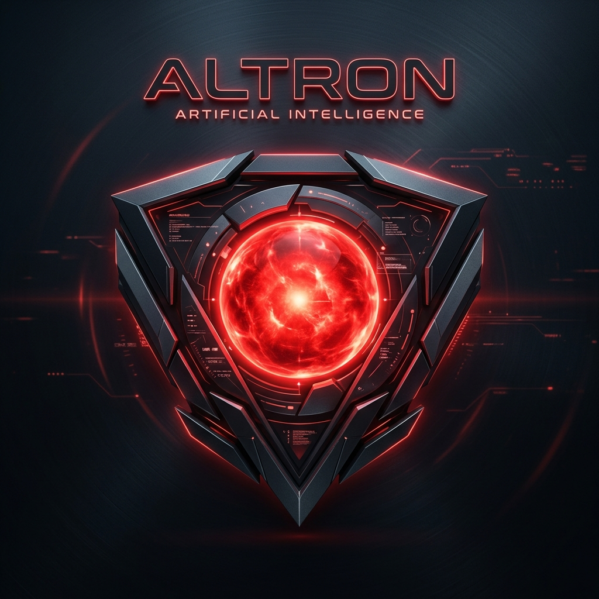

# ALTRON // Quantum Neural Desktop Assistant

**Altron** is an AI-powered Windows desktop assistant featuring a futuristic black-and-red HUD interface, 3D holographic quantum core animation, fast Groq LLM intent routing, direct voice input/output, and a universal Windows application launcher.



---

## Key Features

- **Universal App Launcher**: Open **any** installed application, setting, software, or game on Windows (*"Open Discord"*, *"Open Spotify"*, *"Open Settings"*, *"Open VS Code"*, *"Open Chrome"*).
- **Groq Intent Routing**: Classifies queries, multi-step system actions, web searches, and research requests lightning-fast.
- **Direct MIC Voice Control**: Click the HUD mic button for real-time speech recognition without requiring intrusive background mic locking.
- **Continuous System Speech**: Native Windows SAPI5 / `win32com` text-to-speech that speaks every response cleanly without audio loops hanging.
- **Cyberpunk HUD UI**: WebGL 3D animated core, live telemetry logs, responsive conversation stream, system uptime counters, and status indicators.
- **System Control**: Adjust master audio volume (up, down, mute) and screen display brightness.

---

## 1. Prerequisites & Installation

### Install Python
Install **Python 3.11 or newer** from [python.org](https://www.python.org/downloads/windows/). Ensure **Add Python to PATH** is checked during installation.

### Clone Repository & Setup Virtual Environment
Open PowerShell:

```powershell
# Clone the repository
git clone https://github.com/YOUR_USERNAME/Altron.git
cd Altron

# Create virtual environment
python -m venv .venv
.\.venv\Scripts\Activate.ps1

# Upgrade pip & install dependencies
python -m pip install --upgrade pip
pip install -r requirements.txt
```

---

## 2. API Key Setup

1. Get a free Groq API key at [console.groq.com](https://console.groq.com).
2. Create your private `.env` configuration file from `.env.example`:

   ```powershell
   Copy-Item .env.example .env
   notepad .env
   ```

3. Paste your Groq API key into `.env`:

   ```env
   GROQ_API_KEY=your_actual_groq_api_key_here
   GROQ_MODEL=qwen/qwen3-32b
   ```

> [!IMPORTANT]
> Never commit your `.env` file or API key to GitHub. `.env` is automatically ignored in `.gitignore`.

---

## 3. Running Altron

Activate the virtual environment and run `main.py`:

```powershell
.\.venv\Scripts\Activate.ps1
python main.py
```

Or double-click **`Launch Altron.bat`** on your desktop.

---

## Example Commands

- **Open Applications**: `Open Discord`, `Open Settings`, `Open Spotify`, `Open VS Code`, `Open Notepad`
- **Web Navigation**: `Open youtube.com and search for synthwave music`
- **System Controls**: `Turn volume up by 15 percent`, `Mute volume`, `Set brightness to 80 percent`
- **Research & Chat**: `What is quantum computing?`, `Summarize current AI trends`

---

## Project Structure

```text
Altron/
├── actions/             # System control, dynamic app launcher, and browser actions
├── bridge/              # Async WebSocket server connecting Python backend to HUD frontend
├── logs/                # Local history logs (history.jsonl)
├── src-ui/              # Cyberpunk HUD interface (HTML/CSS/JS + WebGL 3D Core)
│   ├── altron_logo.png
│   ├── app.js
│   ├── index.html
│   ├── jarvis_core.js
│   └── styles.css
├── voice/               # Voice input and native SAPI5 text-to-speech engines
├── .env.example         # Environment template for GitHub
├── .gitignore           # Excludes secrets, virtual environment, and local logs
├── config.py            # Environment configuration loader
├── groq_client.py       # Groq API client wrapper
├── intent_router.py     # AI intent parsing & local action dispatcher
├── main.py              # Application entry point & controller
└── requirements.txt
Made by Strix
To launch the app after inserting the API, go to the terminal and change the directory to the folder, then run "python main.py"
